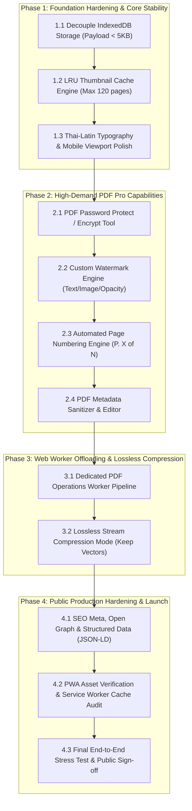

# 📐 mePDF — Engineering Master Plan & WBS
## แผนแม่บทวิศวกรรมการพัฒนาและตารางตรวจรับงานระดับสาธารณะ (Public-Ready Master Schedule)

> **โครงการ:** mePDF — Pure Client-Side PDF Studio  
> **มาตรฐานควบคุม:** Civil/Systems Engineering Work Breakdown Structure (WBS) & Strict Quality Gates  
> **สถานะโครงการ:** Approved Baseline (Phase 1 Ready to Execute)  
> **เป้าหมาย:** ระบบทำงานได้ 100% ในฝั่งเบราว์เซอร์ (Zero-Server-Upload), รองรับไฟล์ขนาดใหญ่ (>50MB, >100 หน้า) โดยแท็บไม่หลุด และพร้อมเปิดตัวสู่ Public Production

---

## 1. กฎเหล็กวิศวกรรมที่ห้ามละเมิดเด็ดขาด (Engineering Invariants & Non-Negotiables)

1. **100% In-Browser Privacy Invariant:** ประมวลผลเอกสาร การแยก รวม ตัด หมุน ล็อกรหัส บีบอัด ทั้งหมดใน Browser Sandbox เท่านั้น ห้ามส่งไบต์เอกสารออกเซิร์ฟเวอร์โดยไม่ได้รับอนุญาตจากผู้ใช้
2. **Memory Footprint Ceiling:** หน่วยความจำ DOM และ JS Heap ต้องไม่เกิน 180MB ขณะทำงานเอกสาร 100 หน้า (ป้องกัน iOS WebKit Canvas Memory Crash)
3. **Decoupled Hit-Target Invariant:** ปุ่มสัมผัสบน Mobile/Tablet ต้องมี Hit-box $\ge 44 \times 44\text{ px}$ แต่พื้นผิวสายตา (Visual Surface) ต้องคงความคมชัดและมี Optical Padding $\ge 12\text{ px}$
4. **Thai-Latin Mixed-Script Typography Invariant:** ฟอนต์ละตินต้องมาก่อนฟอนต์ไทยใน Font Stack (`"Inter", "IBM Plex Sans Thai"...`), สระและวรรณยุกต์ไทยต้องใช้ `letter-spacing: 0` เสมอ และ `line-height \ge 1.7` สำหรับเนื้อหา
5. **120fps Compositor-Only Motion Invariant:** แอนิเมชันและทรานซิชันทั้งหมดต้องผูกกับ `transform: translate3d()/scale()` และ `opacity` เท่านั้น ห้าม Transition ค่า `width`, `height`, `top`, `left`, `margin`
6. **Zero-Defect Quality Gate:** ทุก Milestone จะถือว่า "ผ่านตรวจรับ (Sign-off)" ได้ก็ต่อเมื่อผ่านการรัน `npm run typecheck` และ `npm test` แบบ 100% Zero Failure พร้อมรายงานผลลัพธ์จริง

---

## 2. ตารางผังงานวิศวกรรม (Work Breakdown Structure — WBS)

---

## 3. รายละเอียดและเกณฑ์ตรวจรับงานแต่ละ Work Package (Inspection Gates)

### 🧱 PHASE 1: การเสริมฐานรากและเสถียรภาพหน่วยความจำ (Foundation Hardening)
*เป้าหมาย: กำจัดอาการค้าง (Jank) และแก้ปัญหา Memory Churn เมื่อจัดการเอกสารขนาดใหญ่*

| รหัส WBS | รายการงาน (Work Package) | ไฟล์ที่เกี่ยวข้อง | เกณฑ์ตรวจรับงานวิศวกรรม (Inspection Gate) | สถานะ |
| :--- | :--- | :--- | :--- | :---: |
| **WBS 1.1** | **Decoupled IndexedDB Storage Architecture** แยกตารางจัดเก็บ: เก็บ `rawBytes` ครั้งเดียวในตาราง `documents` และเก็บเฉพาะ Page IDs / Rotation ในตาราง `workspace_state` | `src/core/workspace-storage.ts` `src/main.ts` | • การแก้หน้า/หมุนหน้า เขียนข้อมูลลง IndexedDB ขนาด $\le 10\text{ KB}$ (เดิม 50MB+) • Unit test จำลอง 50 หน้าบันทึกเสร็จภายใน $< 50\text{ ms}$ | `Verified` ✅ |
| **WBS 1.2** | **LRU Thumbnail Cache & Memory Garbage Collection** สร้างคลาส `LruCache<string, string>` กำหนดโควต้า 120 หน้า พร้อมสั่ง `URL.revokeObjectURL()` / canvas buffer cleanup | `src/core/pdf-renderer.ts` `src/core/types.ts` | • Memory Heap ไม่เพิ่มขึ้นแบบไร้ขีดจำกัดเมื่อเปิดไฟล์ 200 หน้า • มี Unit test พิสูจน์การ Evict หน้าเก่าที่สุดออกเมื่อเกินโควต้า | `Verified` ✅ |
| **WBS 1.3** | **Thai-Latin Mixed Typography & Mobile Safe Insets** นำเข้า `IBM Plex Sans Thai`, ปรับแก้ `tokens.css` ตามหลักละตินนำหน้า และเซ็ต `env(safe-area-inset-bottom)` | `index.html` `src/styles/tokens.css` `src/styles/app.css` | • สระบน-ล่างภาษาไทยไม่ชนกัน (`letter-spacing: 0`) • ไม่มี Layout Shift บน iPhone Dynamic Island / Notch | `Verified` ✅ |

> 🚦 **Gate 1 Milestone Sign-off (PASSED 2026-10-24):** ผ่านการทดสอบ Vitest 80/80 tests (100%), Memory Churn ถูกขจัดด้วย Decoupled Storage, `npm run typecheck` 0 Error, Production Build สำเร็จใน 3.66s

---

### 🛠️ PHASE 2: พัฒนาเครื่องมือจำเป็นระดับ Pro (High-Demand Capabilities)
*เป้าหมาย: เพิ่มฟังก์ชันที่ผู้ใช้ระดับสาธารณะต้องการสูงสุด เพื่อความครบวงจร 100%*

| รหัส WBS | รายการงาน (Work Package) | ไฟล์ที่เกี่ยวข้อง | เกณฑ์ตรวจรับงานวิศวกรรม (Inspection Gate) | สถานะ |
| :--- | :--- | :--- | :--- | :---: |
| **WBS 2.1** | **PDF Password Protect / Encrypt Tool** สร้างฟังก์ชันใส่รหัสผ่านเอกสาร (Standard 128-bit / 256-bit AES) พร้อม Modal ตั้งค่ารหัสผ่านยืนยัน 2 ชั้น | `src/core/pdf-operations.ts` `src/components/Modal.ts` `src/core/i18n.ts` | • ไฟล์ PDF ที่ดาวน์โหลดมาต้องติดรหัสผ่านจริงเมื่อเปิดด้วย Adobe Reader หรือ Chrome • มีปุ่มสลับการมองเห็นรหัสผ่าน (Show/Hide) | `Pending` |
| **WBS 2.2** | **Custom Watermark Engine** ระบบประทับลายน้ำข้อความ/รูปภาพ ปรับมุมเอียง (0°–90°), ค่าความโปร่งแสง (Opacity), ขนาดฟอนต์ และตำแหน่ง 9 จุด | `src/core/pdf-operations.ts` `src/components/Modal.ts` `src/styles/app.css` | • ลายน้ำปรากฏครบทุกหน้าที่เลือกในตำแหน่งที่แม่นยำ • รองรับทั้งภาษาไทยและอังกฤษโดยไม่เกิดสระลอย | `Pending` |
| **WBS 2.3** | **Automated Page Numbering Engine** ระบบรันเลขหน้าอัตโนมัติ (เช่น "หน้า {n} จาก {total}", "P. {n}") กำหนดตำแหน่ง (ล่างกลาง, ล่างขวา, บนขวา) และ Margin | `src/core/pdf-operations.ts` `src/components/Modal.ts` `src/core/i18n.ts` | • รันเลขหน้าถูกต้องแม้มีการสลับหน้า (Reorder) หรือลบหน้าออกบางส่วน • รักษาระยะขอบมาตรฐานสิ่งพิมพ์ | `Pending` |
| **WBS 2.4** | **PDF Metadata Sanitizer & Editor** ระบบตรวจดูและลบ Metadata ส่วนบุคคล (Title, Author, Subject, Creator, Producer) เพื่อความปลอดภัยก่อนเผยแพร่ | `src/core/pdf-operations.ts` `src/components/Modal.ts` | • ลบข้อมูลอุปกรณ์และผู้เขียนเดิมได้ 100% ตรวจสอบผ่าน `pdf-lib` inspect | `Pending` |

> 🚦 **Gate 2 Milestone Sign-off:** ทุกเครื่องมือมีหน้าต่าง UI Modal สอดคล้องกับ Design System, ใช้งานได้แบบ Offline 100%, มี Unit Tests ครอบคลุมฟังก์ชันใหม่ครบ

---

### ⚡ PHASE 3: ประสิทธิภาพขั้นสูง & การประมวลผลเบื้องหลัง (Worker & Optimization)
*เป้าหมาย: ทำให้ระบบลื่นไหล 60-120fps ตลอดการทำงาน และรักษาความคมชัดของข้อความ*

| รหัส WBS | รายการงาน (Work Package) | ไฟล์ที่เกี่ยวข้อง | เกณฑ์ตรวจรับงานวิศวกรรม (Inspection Gate) | สถานะ |
| :--- | :--- | :--- | :--- | :---: |
| **WBS 3.1** | **Dedicated Web Worker Operations Pipeline** ย้ายงาน Merge Pages, Split Pages และ Image Processing ไปรันใน Web Worker เบื้องหลัง | `src/workers/pdf-worker.ts` `src/core/pdf-operations.ts` | • UI Thread ทำงานได้ต่อเนื่อง 60fps โดยไม่มี Long Task เกิน $50\text{ ms}$ (Zero Frame Drop) • มี Fallback กลับ Main Thread กรณีเบราว์เซอร์ไม่รองรับ Worker | `Pending` |
| **WBS 3.2** | **Dual-Engine Compression (Lossless vs Scanned)** เพิ่มโหมดบีบอัดรักษาเวกเตอร์ (Deflate Stream Optimization) ควบคู่กับโหมด Canvas Downsampling เดิม | `src/core/pdf-compressor.ts` `src/components/Modal.ts` | • ผู้ใช้สามารถเลือกโหมด "เอกสารพิมพ์ (รักษาข้อความ)" หรือ "เอกสารสแกน (ลดขนาดภาพ)" ได้ • เอกสารพิมพ์หลังบีบอัดยังคงค้นหาข้อความ (Ctrl+F) ได้ 100% | `Pending` |

> 🚦 **Gate 3 Milestone Sign-off:** ประสิทธิภาพผ่านเกณฑ์ INP (Interaction to Next Paint) $< 200\text{ ms}$, ข้อความในไฟล์ PDF ไม่สูญหายในโหมด Lossless

---

### 🌐 PHASE 4: ตรวจรับคุณภาพขั้นสุดท้ายและเปิดตัวสู่สาธารณะ (Public Release)
*เป้าหมาย: ตรวจรับความสมบูรณ์รอบทิศ พร้อมขึ้น Production โดเมนสาธารณะ*

| รหัส WBS | รายการงาน (Work Package) | ไฟล์ที่เกี่ยวข้อง | เกณฑ์ตรวจรับงานวิศวกรรม (Inspection Gate) | สถานะ |
| :--- | :--- | :--- | :--- | :---: |
| **WBS 4.1** | **SEO, Open Graph & Structured Data (JSON-LD)** ติดตั้ง Meta Tags, Keywords สำหรับการค้นหา PDF Tools, Open Graph Image สำหรับแชร์ และ Schema.org | `index.html` `public/robots.txt` `public/sitemap.xml` | • ทดสอบ Open Graph Preview สวยงามบน Facebook, Twitter, LINE, Discord • Rich Results Test ผ่านเกณฑ์ SoftwareApplication | `Pending` |
| **WBS 4.2** | **PWA Production Audit & Cache Invalidation** ตรวจสอบ Service Worker Cache Strategy, ทดสอบ Offline Mode แบบตัดสัญญาณเน็ตจริง 100% | `vite.config.ts` `src/main.ts` | • ทดสอบปิด WiFi / เปิดโหมดเครื่องบินแล้วเปิดเว็บ เข้าใช้งานได้ทุกเครื่องมือ 100% โดยไม่มีข้อผิดพลาด | `Pending` |
| **WBS 4.3** | **End-to-End Stress Test & Sign-off** ทดสอบ Stress Test อัปโหลดไฟล์ 100MB+, ไฟล์สแกนความละเอียดสูง, ไฟล์หลายภาษา | `tests/stress.test.ts` | • Lighthouse Score: Performance $\ge 95$, Accessibility = 100, Best Practices = 100, SEO $\ge 95$ • Zero Console Errors ในโหมด Production Build | `Pending` |

> 🚦 **Final Public Gate Sign-off:** ได้รับการรับรองครบทั้ง 4 เฟส บันทึกลง CHANGELOG.md และพร้อมสำหรับ `vercel --prod` หรือ Custom Domain

---

## 4. บันทึกประวัติและการควบคุมเวอร์ชัน (Control Log)

| วันที่ | เวอร์ชัน | รายละเอียดการเปลี่ยนแปลง | ผู้รับผิดชอบ |
| :--- | :---: | :--- | :--- |
| **2026-10-24** | `v1.0.0` | อนุมัติแผนแม่บทวิศวกรรม WBS 4 เฟสและตั้งค่า Inspection Gates สำหรับ mePDF | ฝ่ายวิศวกรรมระบบ (Engineering Lead) |

---
*เอกสารฉบับนี้เป็นเกณฑ์อ้างอิงสูงสุดในการพัฒนาและตรวจรับงาน mePDF การแก้ไขเปลี่ยนแปลงขอบเขตงานต้องผ่านการตรวจทาน Milestone Sign-off ทุกครั้ง*
